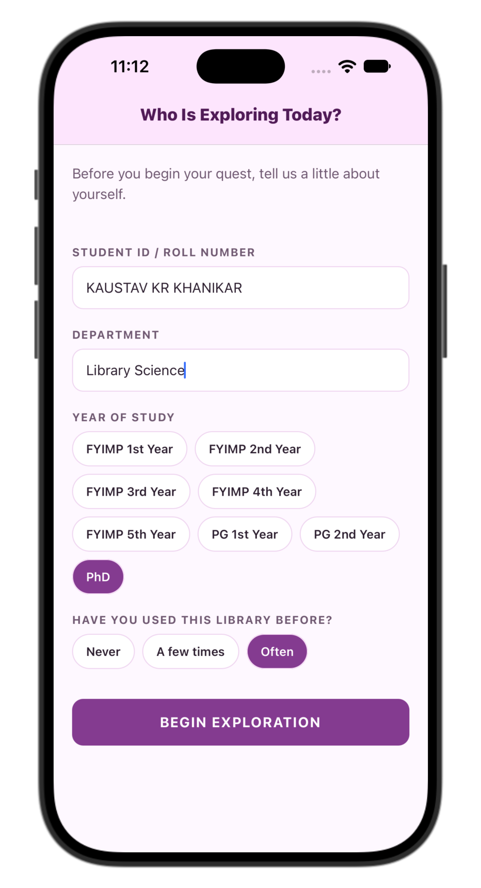
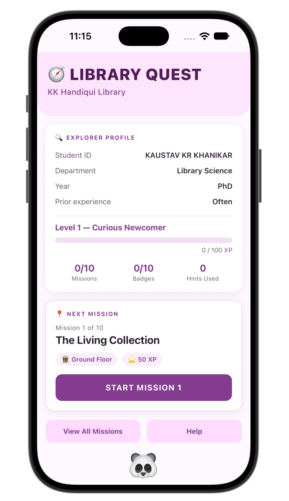
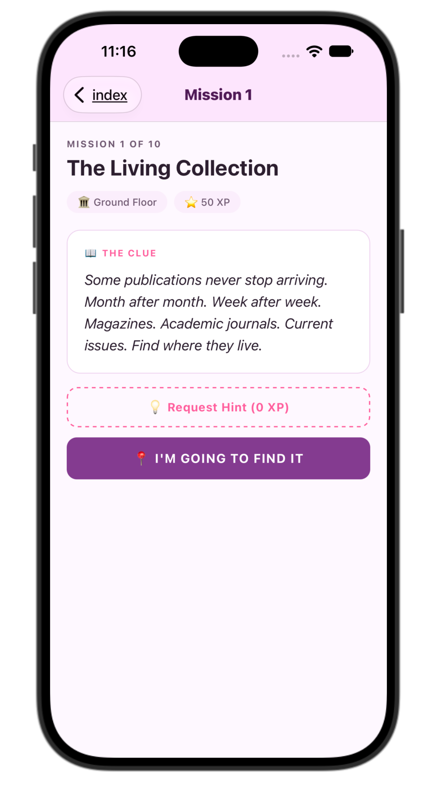
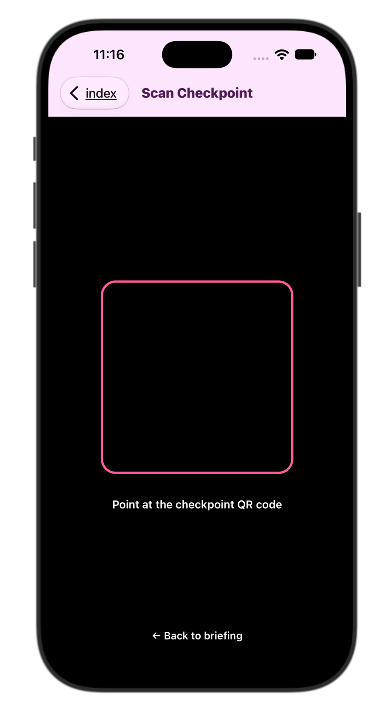
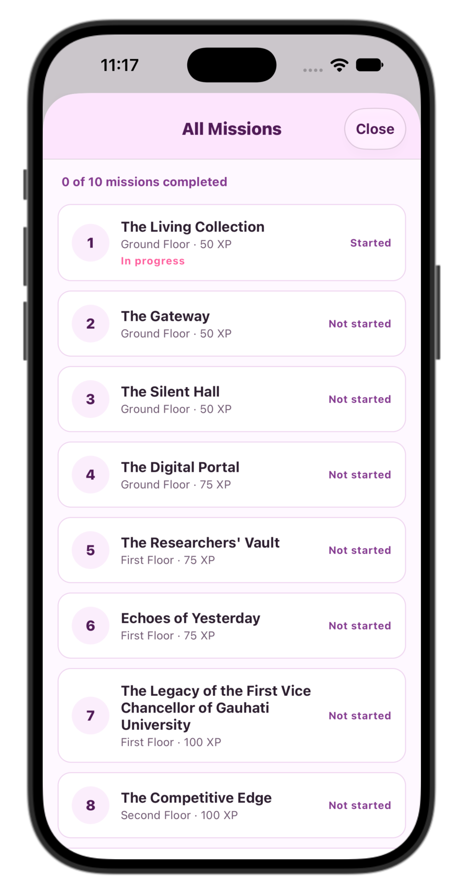
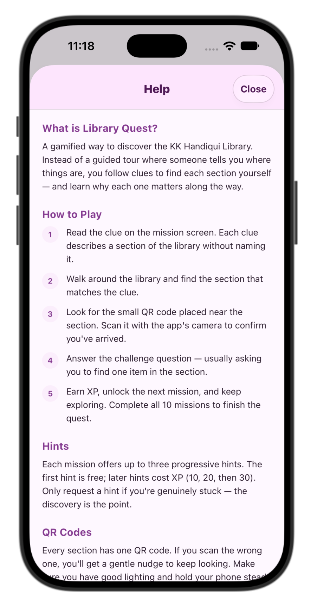

<div inline="block">

  
  
  
  
  
  
  
  
  
</div>
# Library Quest

A gamified mobile application for library discovery and navigation, developed for the KK Handiqui Library at Gauhati University. Students explore the physical library by following mission-based clues and scanning QR checkpoints, earning XP and badges as they discover each section.

This application was developed as part of a research study on gamification in library instruction. It was pilot-tested with 17 fourth-year students in October 2026.

---

## 📖 Overview

Traditional library orientation in Indian universities is typically delivered as a one-time presentation without any physical walkthrough. Students learn *that* the library exists but never develop spatial familiarity with its sections, shelves, or services. By the time they need the library for coursework, the presentation is forgotten and confidence is low.

**Library Quest** addresses this gap by turning the library itself into a game board. Instead of being told where sections are, students discover them through:

- **Mission-based clues** — riddles that describe a section without naming it
- **Physical exploration** — students walk to the section they believe matches the clue
- **QR checkpoints** — one code per section, scanned with the phone camera
- **Challenge questions** — short tasks requiring physical interaction with library materials
- **Progressive rewards** — XP, levels, and badges that unlock the next mission

The application was designed to be **offline-capable**, **server-free**, and **low-threshold** — it runs on any mid-range Android or iOS device and requires no internet connection after installation.

---

## 🎯 Research Context

This application was built to evaluate the feasibility and perceived impact of a gamified library-discovery intervention. Three research questions guided the study:

1. **RQ1.** Can a gamified mobile application facilitate independent navigation and discovery of a multi-floor academic library?
2. **RQ2.** How do students perceive the gamified experience in terms of engagement, learning, enjoyment, and navigation self-efficacy?
3. **RQ3.** What design features of the application influence the depth of student engagement with library spaces?

### Key Findings from the Pilot

| Finding | Result |
|---------|--------|
| Mission completion rate | 100% (170/170) |
| Mean quest duration | 20.7 minutes (range: 9.6 – 27.9) |
| Hint usage | 3 of 510 possible (0.6%) |
| Enjoyment (5-point scale) | M = 5.00, SD = 0.00 |
| Navigation self-efficacy | M = 4.61, SD = 0.40 |
| Post-quest confidence (0–10) | M = 9.06, SD = 0.83 |
| Preference vs. traditional orientation | 82.4% "more" or "much more" useful |

**Central design insight:** QR checkpoint placement directly shapes the depth of student engagement with library spaces. Missions with checkpoints placed immediately inside a section entrance were completed in ~20 seconds; missions requiring students to locate a specific shelf took up to ~200 seconds.

---

## 🧭 The Ten Missions

The application guides students through ten sections across three floors of the KK Handiqui Library:

| # | Mission Title | Target Section | Floor |
|---|---------------|----------------|-------|
| 1 | The Living Collection | Periodical Section | Ground |
| 2 | The Gateway | Circulation Section | Ground |
| 3 | The Silent Hall | Reading Room | Ground |
| 4 | The Digital Portal | OPAC Terminals | Ground |
| 5 | The Researchers' Vault | Reference Section 1 | First |
| 6 | Echoes of Yesterday | Archival Section | First |
| 7 | The Scholar's Legacy | KK Handiqui Collection | First |
| 8 | The Competitive Edge | Competitive Exam Section | Second |
| 9 | The Voice of Assam | Bhupen Hazarika Collection | Second |
| 10 | The Inclusive Corner | Divyang Corner | Ground |

Each mission includes:

- A **clue** (riddle describing the section)
- Up to **three progressive hints** (costing 10, 20, and 30 XP)
- A unique **QR code** for the physical checkpoint
- A **challenge question** requiring physical interaction with the section

---

## 🛠️ Tech Stack

| Layer | Technology |
|-------|------------|
| Framework | [React Native](https://reactnative.dev) (via [Expo](https://expo.dev)) |
| Language | TypeScript |
| Navigation | Expo Router (file-based routing) |
| Camera | `expo-camera` (QR scanning via `CameraView`) |
| Local Storage | `expo-sqlite` (SQLite embedded database) |
| File Export | `expo-file-system` + `expo-sharing` |
| Animation | React Native `Animated` API + `react-native-animatable` |
| Safe Areas | `react-native-safe-area-context` |

**No backend server is required.** All logic, storage, and computation run on the student's device.

---

## 📁 Project Structure
LibraryQuest/
├── src/
│ ├── app/ # Expo Router screens (routes)
│ │ ├── _layout.tsx # Root layout (SQLite + Stack)
│ │ ├── index.tsx # Profile / dashboard screen
│ │ ├── registration.tsx # Student registration form
│ │ ├── quest-complete.tsx # Final screen with CSV export
│ │ ├── missions.tsx # Modal: all missions list
│ │ ├── help.tsx # Modal: usage instructions
│ │ └── mission/
│ │ └── [id].tsx # Mission flow (briefing → scan → challenge → complete)
│ ├── components/
│ │ ├── Stat.tsx # Reusable stat display
│ │ └── EmojiAnimal.tsx # Animated mascot on profile screen
│ ├── data/
│ │ └── missions.ts # Mission catalogue + level thresholds
│ ├── db/
│ │ ├── database.ts # SQLite schema and operations
│ │ └── export.ts # CSV generation and sharing
│ ├── theme/
│ │ └── colors.ts # Design tokens
│ └── types/
│ └── index.ts # TypeScript interfaces
├── assets/
├── app.json # Expo configuration
├── tsconfig.json # TypeScript + path aliases
├── package.json
└── README.md


**Path alias:** `@/` resolves to `src/`. So `import { MISSIONS } from '@/data/missions'` refers to `src/data/missions.ts`.

---

## 🚀 Getting Started

### Prerequisites

- **Node.js** 18 or newer ([download](https://nodejs.org))
- **npm** (bundled with Node) or **yarn**
- **Expo Go** app on your phone ([Android](https://play.google.com/store/apps/details?id=host.exp.exponent) · [iOS](https://apps.apple.com/app/expo-go/id982107779))

### Installation

```bash
git clone https://github.com/YOUR_USERNAME/library-quest.git
cd library-quest
npm install
```

### Running in development
```bash
npx expo start
```
A QR code appears in your terminal. Scan it with:

- Android: Expo Go app

- iOS: Camera app (which will open it in Expo Go)

The app loads on your phone and hot-reloads as you edit files.

Clear cache if you see stale behaviour:
```bash
npx expo start --clear
```

### Type Checking
```bash
npx tsc --noEmit
```

## 🗄️ Database Schema
The application uses SQLite (via expo-sqlite) with three tables.

`profile` — Student Registration
Stores a single row per device. Constrained with `CHECK (id = 1)` because only one student uses a given install.
| Column | Type |	Description |
|--------|------|-------------|
| id | INTEGER | Always 1 |
| student_id | TEXT | Student ID / roll number |
| department |	TEXT |	Department name |
| year_of_study |	TEXT |	Year (e.g., "FYIMP 4th Year") |
| prior_experience |	TEXT |	"Never" / "A few times" / "Often" |
| created_at |	INTEGER |	Unix ms timestamp |

`mission_progress` — Per-Mission State
| Column | Type |	Description |
|--------|------|-------------|
| mission_id |	INTEGER PK |	1–10 |
| status |	TEXT |	"available" / "completed" |
| started_at |	INTEGER |	Unix ms |
| completed_at |	INTEGER |	Unix ms |
| hints_used |	INTEGER |	0–3 |
| xp_earned |	INTEGER |	Final XP after hint penalty |
| challenge_answer |	TEXT |	Student's typed response |

`interaction_log` — Raw Event Log
| Column | Type |	Description |
|--------|------|-------------|
| id |	INTEGER PK AUTOINCREMENT |	— |
| mission_id |	INTEGER |	Nullable |
| event_type |	TEXT |	See event types below |
| event_data |	TEXT |	JSON payload |
| timestamp |	INTEGER |	Unix ms |

### Event types logged:

- `mission_started`
- `hint_used` — payload: `{ hintLevel: 1|2|3 }`
- `qr_scan_success` — payload: `{ code: "LIBQUEST-..." }`
- `qr_scan_failure` — payload: `{ scanned: "..." }`
- `mission_completed` — payload: `{ xpEarned, hintsUsed }`
- `challenge_answered` — payload: `{ answer: "..." }`

## 📤 Data Export
On the Quest Complete screen, students can export their data as two CSV files:

| File | Description |
|------|-------------|
| `LibraryQuest_<ID>_missions_<timestamp>.csv`	| One row per mission — analysis-ready |
| `LibraryQuest_<ID>_log_<timestamp>.csv`	| One row per event — raw timeline |

Files are generated on-device and shared via the native share sheet (`expo-sharing`). No data leaves the device until the student explicitly chooses to share it.

### Missions CSV Columns
`student_id, department, year_of_study, prior_experience, registered_at_iso, mission_id, mission_title, target_section, floor, status, started_at_iso, completed_at_iso, duration_seconds, hints_used, xp_earned, scan_successes, scan_failures, challenge, challenge_answer`

Log CSV Columns
`student_id, event_id, mission_id, event_type, event_data, timestamp_iso, timestamp_ms`

## 🎴 QR Checkpoint Setup
Each mission expects a specific QR code. The application's scanner reads the raw encoded string and compares it against the expected value.

### QR Code Format
```bash
LIBQUEST-<SECTION>-<NUMBER>
```
**Example**: `LIBQUEST-PERIOD-01`

### Full List of Codes
| # | Section | QR Code String |
|---|---------|----------------|
| 1 |	Periodical Section |	LIBQUEST-PERIOD-01 |
| 2 | Circulation Section |	LIBQUEST-CIRC-02 |
| 3 |	Reading Room |	LIBQUEST-READ-03 |
| 4 |	OPAC Terminals |	LIBQUEST-OPAC-04 |
| 5 |	Reference Section 1 |	LIBQUEST-REF1-05 |
| 6 |	Archival Section |	LIBQUEST-ARCH-06 |
| 7 |	KK Handiqui Collection |	LIBQUEST-KKH-07 |
| 8 |	Competitive Exam Section |	LIBQUEST-COMP-08 |
| 9 |	Bhupen Hazarika Collection |	LIBQUEST-BHUP-09 |
| 10 | Divyang Corner |	LIBQUEST-DIVY-10 |

### Generating the QR Codes
Install the `qrcode` package as a dev dependency and run a generator script, or use any plain-text QR generator online.

**⚠️ Do not use URL-based QR generators**. Some services encode a redirect URL instead of your raw text. The scanner will read the redirect URL and reject it. Always test a generated code with your phone's camera first — it should display the raw string, not a website link.

### Recommended Physical Placement
- Print on **matte paper** (glossy causes glare and scanning failures)
- Size: ~**5 × 5 cm**; larger is better
- Height: **1.4–1.6 m** from floor
- Position: **inside the section**, not on the corridor wall — this forces physical entry
- Label with the section name below the QR (so staff and non-participants know what it is)
- Get **library staff approval** before placing anything

## 🏗️ Building for Distribution
The app is distributed to students using **EAS Build** (Expo Application Services). This generates installable APK (Android) and IPA (iOS) builds without requiring local Android Studio or Xcode.

### One-Time Setup
```bash
npm install -g eas-cli
eas login
eas build:configure
```

### Android — Preview APK (Recommended for Research Studies)
Ensure `eas.json` has a `preview` profile with `"buildType": "apk"`:

```bash
{
  "build": {
    "preview": {
      "distribution": "internal",
      "android": {
        "buildType": "apk"
      }
    },
    "production": {}
  }
}
```
Then build:

```bash
eas build -p android --profile preview
```
EAS returns a URL and QR code. Distribute this to participants — they download the APK and install it.

### iOS — Ad Hoc or TestFlight
Requires a paid Apple Developer account. Options:

- **Ad Hoc** — register up to 100 device UDIDs and distribute directly

- **TestFlight** — submit via `eas submit -p ios` and invite testers through App Store Connect

### Known Issue: `expo-barcode-scanner` Conflict
The deprecated `expo-barcode-scanner` package must not be present in package.json or app.json. The application uses `expo-camera`'s `CameraView` for QR scanning. If you see a Kotlin compile error mentioning :`expo-barcode-scanner:compileReleaseKotlin`, check:

- `package.json` — remove any reference to `expo-barcode-scanner`
- `app.json` — remove `"expo-barcode-scanner"` from the plugins array

Then run `npx expo prebuild --clean` before rebuilding.


## 🎨 Customisation
Most of the study's content is data-driven and can be edited without touching component code.

| What to change | File | Field |
|----------------|------|-------|
| Mission titles, clues, challenges |	`src/data/missions.ts` |	`title`, `clue`, `challenge` |
| Hint text (per mission) |	`src/app/mission/[id].tsx` |	`getHintText()` function |
| Hint XP costs |	`src/app/mission/[id].tsx` |	`HINT_COSTS` array |
| Mission XP rewards |	`src/data/missions.ts` |	`baseXP` |
| QR code strings |	`src/data/missions.ts` |	`qrCode` |
| Colour theme |	`src/theme/colors.ts` |	All tokens |
| Level thresholds |	`src/data/missions.ts` |	`LEVEL_THRESHOLDS` |
| Mascot animal roster |	`src/components/EmojiAnimal.tsx` |	`ANIMALS` array |

**Important**: If you change any `qrCode` in `missions.ts`, you must regenerate the corresponding physical QR codes. The two must match exactly.


## 📱 Application Workflow
```text
Registration → Profile → Mission Briefing → QR Scan → Challenge → Complete
                                                                ↓
                                                          Next Mission
                                                                ↓
                                                    (repeat for all 10)
                                                                ↓
                                                         Quest Complete
                                                                ↓
                                                        Export Data (CSV)
```
See Figure 1 in the research paper for a visual walkthrough of all screens.


## 📸 Screenshot
<div style="align:center">
 
</div>
<div style="align:center">
 
</div>
<div style="align:center">
 
</div>
<div style="align:center">
 
</div>
<div style="align:center">
 
</div>
<div style="align:center">
 
</div>


## ⚠️ Limitations
This application was designed and evaluated as a **research pilot**, not as a production library system.
- **Single-institution design**. QR codes and mission content are specific to the KK Handiqui Library. Adapting to another library requires rewriting `missions.ts` and regenerating the QR codes.
- **No multi-user support**. The database assumes one profile per device (`CHECK id = 1`).
- **No authentication or backend**. Data lives only on the student's device until exported.
- **Development build distribution**. The pilot was distributed via Expo development server, which caused installation issues for some participants. A production-ready deployment should use EAS preview builds or app store submission.
- **Small pilot sample**. The study's findings should be interpreted as preliminary signals, not as generalisable results.

## 🤝 Contributing
This project is primarily a research artefact. If you adapt it to another library, I'd love to hear about it — please open an issue or reach out.

If you wish to contribute code improvements:

- Fork the repository
- Create a feature branch (`git checkout -b feature/improvement`)
- Commit your changes (`git commit -m "Add improvement"`)
- Push to the branch (`git push origin feature/improvement`)
- Open a Pull Request

## 📄 License
If you plan to reuse, adapt, or build on this work, please add an appropriate license (MIT is standard for research software). Without a license, the code is technically "all rights reserved" and cannot be legally reused.

To add an MIT license:
```bash
npx license mit > LICENSE
```

📚 Citation
If you use this application or build on this work, please cite:
```bash
@misc{khanikar2026libraryquest,
  author       = {Khanikar, Kaustav},
  title        = {Library Quest: A Gamified Mobile Application for Library Discovery and Navigation},
  year         = {2026},
  publisher    = {GitHub},
  howpublished = {\url{https://github.com/YOUR_USERNAME/library-quest}},
  note         = {Developed at Gauhati University, KK Handiqui Library}
}
```

## 👤 Author
**Kaustav Khanikar**
Department of Library and Information Science
Gauhati University

## 🙏 Acknowledgements
- **KK Handiqui Library, Gauhati University** — for permission to place QR checkpoints and conduct the pilot study
- **The 17 pilot participants** — whose honest feedback shaped the design insights in this work
- **Library staff** — for reviewing QR placement and accommodating the activity
- **Open-source community** — React Native, Expo, and the libraries this project builds upon

📞 Contact
For questions about the research or the application:

- Open an issue on this repository
- Email: kkhanikar@gauhati.ac.in

***Library Quest was designed and developed by Khanikar, KK as part of a study on gamification in library instruction.***